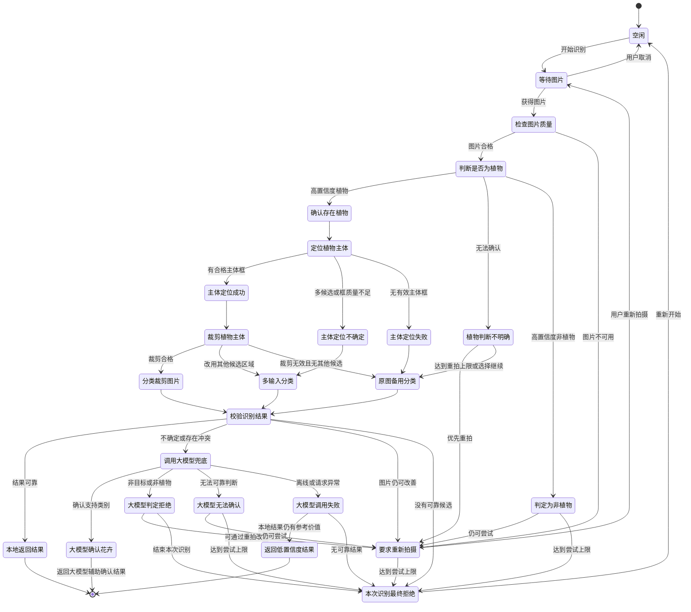

# 智慧花园识别状态机设计说明 v1.0

## 1. 文档目的

本文定义智慧花园花卉识别流程 v1.0 的状态机设计，明确图片质量检查、植物判断、主体定位、图片裁剪、花卉分类、结果校验、重新拍摄和 LLM 兜底之间的关系。

本设计以识别准确性为优先目标，允许通过重新拍摄和多次本地推理提高最终识别成功率。每个阶段负责一种主要任务，并为前置阶段失败保留备用路径。

## 2. 设计范围

v1.0 包含以下处理阶段：

1. 图片质量检查；
2. 植物二分类；
3. 植物主体定位；
4. 主体裁剪；
5. 9 类 YOLO 花卉分类；
6. 结果校验与拒识；
7. 本地结果返回；
8. LLM 兜底；
9. 重新拍摄和最终拒绝。

v1.0 的主体定位默认使用输出 bounding box 的目标检测模型。实例分割 mask 不作为本版本的必选方案，只有在后续验证 bbox 对重叠植物、复杂背景或轮廓处理不足时再引入。

## 3. 设计原则

### 3.1 分层处理

- 植物分类器判断图片是否值得继续识别；
- 定位模型寻找植物或花卉主体的位置；
- 裁剪流程提高主体在分类输入中的占比；
- YOLO 分类模型识别具体花卉类别；
- 结果校验判断本地结果是否足够可靠；
- LLM 处理低置信度、冲突和非典型样本。

### 3.2 高精度优先

第一阶段采用较高的植物确认标准，保证明确放行到后续流程的图片质量。判断不明确时优先提示用户调整角度、距离或光线后重新拍摄。

### 3.3 允许恢复

任何前置阶段失败都不应直接等同于整个识别失败。定位失败时保留原图分类备用路径；分类不稳定时可以调用 LLM 或重新拍摄；只有在没有可靠结果时才最终拒绝。

### 3.4 拒识优先于强行分类

当前 9 类 YOLO 是闭集分类模型。非训练目标也可能在 9 个类别中得到较高概率，因此最高 softmax 概率不能单独代表真实可信度，必须结合定位质量、输入质量、分类稳定性和结果一致性进行校验。

### 3.5 端侧可扩展

状态机既支持手机端交互式重新拍摄，也支持 RK3588 等边缘设备上的多次采集和离线重复推理。LLM 不可用时，系统仍可通过本地模型和拒识逻辑降级处理。

## 4. 总体流程

```text
开始识别
    ↓
图片质量检查
    ├─ 符合条件 → 植物二分类
    └─ 不符合条件 → 重新拍摄

植物二分类
    ├─ 判断为植物 → 植物主体定位
    ├─ 判断不明确 → 重新拍摄
    └─ 判断为非植物 → 重新拍摄或结束识别

植物主体定位
    ├─ 成功定位 → 主体裁剪
    ├─ 多目标或定位不稳定 → 多候选区域分类
    └─ 定位失败 → 原图备用识别

主体裁剪
    ├─ 裁剪区域合格 → 9 类 YOLO 花卉分类
    └─ 裁剪区域不合格 → 使用其他候选区域或原图分类

9 类 YOLO 花卉分类
    ├─ 产生稳定结果 → 结果校验
    ├─ 结果不稳定 → 结果校验并准备调用 LLM
    └─ 无有效结果 → 重新拍摄或调用 LLM

结果校验
    ├─ 结果可靠 → 本地返回
    ├─ 结果不确定或存在冲突 → LLM 兜底
    ├─ 图片仍有改善空间 → 重新拍摄
    └─ 没有可靠结果 → 最终拒绝

LLM 兜底
    ├─ 确认目标花卉 → 返回辅助确认结果
    ├─ 判断非目标或非植物 → 拒绝或重新拍摄
    ├─ 无法确认 → 重新拍摄
    └─ 调用失败 → 本地降级返回或最终拒绝
```

## 5. 状态定义

以下状态图使用中文功能名称，便于阅读；下方状态定义保留英文状态标识，并补充中文功能说明。图中表示的是 v1.0 设计方案，不代表当前生产代码已实现全部阶段。



### 5.1 `IDLE`：等待开始识别

没有正在处理的识别任务，等待用户开始识别或重新识别。用户拍照或选择相册图片后进入 `CAPTURE_PENDING`。

### 5.2 `CAPTURE_PENDING`：等待拍照或选择图片

等待相机或相册提供图片。获得图片后进入 `IMAGE_QUALITY_CHECK`；用户取消则返回 `IDLE`。

### 5.3 `IMAGE_QUALITY_CHECK`：判断图片是否可用

检查图片是否适合继续处理，不负责判断是否为植物。建议检查图片是否损坏、尺寸是否过小、是否严重模糊、过曝、欠曝或主体不可见。

- 若图片清晰、曝光和尺寸基本合格，进入 `PLANT_CLASSIFY`；
- 若图片明显不可用，进入 `RETAKE_REQUIRED`。

### 5.4 `PLANT_CLASSIFY`：植物与非植物分类

使用训练得到的植物二分类网络判断图片是否包含植物。模型类别仍为 `plant / non-plant`，产品层根据输出分为三种处理情况：

- 高置信度植物：进入 `PLANT_CONFIRMED`；
- 判断不明确：进入 `PLANT_UNCERTAIN`；
- 高置信度非植物：进入 `NON_PLANT_REJECTED`。

中间状态只是决策策略，不代表训练模型增加了第三个类别。

### 5.5 `PLANT_CONFIRMED`：通过植物判断

图片通过植物二分类器的放行条件，可以进入 `PLANT_LOCATE`。应记录植物分数、模型版本和推理耗时。

### 5.6 `PLANT_UNCERTAIN`：无法直接确认是否为植物

图片可能包含植物，但当前画面不足以直接确认。默认进入 `RETAKE_REQUIRED`。达到重拍上限或用户选择继续时，可以进入 `ORIGINAL_CLASSIFY_FALLBACK`，保留一次原图备用分类机会。

### 5.7 `NON_PLANT_REJECTED`：疑似不是植物

植物二分类器认为当前图片大概率不是植物。系统提示用户重新拍摄；达到最大尝试次数后进入 `SESSION_REJECTED`。

### 5.8 `PLANT_LOCATE`：寻找植物或花卉位置

使用目标检测模型寻找植物或花卉主体，默认输出 bbox。定位模型主要确定主体位置，不负责识别具体花种。

- 目标框清晰完整，进入 `LOCATION_CONFIRMED`；
- 存在多个候选、框过小或结果一般，进入 `LOCATION_UNCERTAIN`；
- 没有有效目标框，进入 `LOCATION_FAILED`。

### 5.9 `LOCATION_CONFIRMED`：检测到合格主体

检测到质量合格的植物或花卉主体，包括目标面积合适、框没有明显异常、目标没有被严重截断且位于有效图像范围内。随后进入 `CROP_IMAGE`。

### 5.10 `LOCATION_UNCERTAIN`：存在多个或不完整候选

检测到候选目标，但无法确定唯一或完整主体，例如多植物重叠、目标过小、目标贴近边缘或检测置信度一般。可以保留原图和多个候选裁剪图，进入 `MULTI_INPUT_CLASSIFY`。

### 5.11 `LOCATION_FAILED`：没有找到有效主体

没有找到有效 bbox。默认进入 `ORIGINAL_CLASSIFY_FALLBACK`，使用原图运行一次分类，避免定位漏检直接造成最终漏检。

### 5.12 `CROP_IMAGE`：按检测框截取主体区域

根据 bbox 从原始图片中裁剪植物主体：

1. 使用原始图片坐标；
2. 在 bbox 四周保留适当边距；
3. 将坐标限制在有效范围内；
4. 尽量保持目标比例；
5. 使用与分类模型一致的 letterbox 和归一化；
6. 转换为分类模型要求的输入尺寸。

不建议第一版直接按 mask 抠掉所有背景。适量背景、叶片和茎部信息可能有助于分类，过度抠图也可能造成训练输入与实际输入不一致。

### 5.13 `CROPPED_CLASSIFY`：识别裁剪后的主体

将主体裁剪图送入现有 9 类 YOLO 花卉分类模型。当前 ONNX 输出已经内嵌 softmax，输出即为分类概率，不能再次执行 softmax。

建议保留第一候选类别、第一和第二候选概率、概率差值、输出熵、模型版本和推理耗时，然后进入 `RESULT_VALIDATE`。

### 5.14 `ORIGINAL_CLASSIFY_FALLBACK`：直接识别完整原图

定位失败、裁剪质量不合格或需要与裁剪图对比时，使用原图直接运行 YOLO 分类。原图结果不能自动覆盖裁剪图结果，应与输入质量、分类稳定性和定位信息一起进入 `RESULT_VALIDATE`。

### 5.15 `MULTI_INPUT_CLASSIFY`：比较原图与多个候选区域

当图片中存在多个候选目标或定位结果不稳定时，可以同时处理原图、多个候选框裁剪图以及多次拍摄中的高质量图片。

最终选择不能只看哪个结果的 softmax 最大，应综合植物分数、检测置信度、裁剪质量、图像质量、分类概率差值和多个输入之间的一致性。

### 5.16 `RESULT_VALIDATE`：判断结果是否可靠

结果校验判断本地识别结果是否达到直接返回的要求。建议检查：

- 植物二分类结果是否满足当前路径要求；
- 定位结果是否可靠；
- 裁剪是否完整；
- YOLO 分类是否稳定；
- 第一名与第二名的差距是否合理；
- 输出是否过于分散；
- 原图和裁剪图结果是否一致；
- 是否疑似非目标植物或非植物；
- 图片质量是否支持当前结论。

结果可靠时进入 `LOCAL_SUCCESS`；结果低置信度、存在冲突或疑似非目标时进入 `LLM_FALLBACK`；图片明显需要改善时进入 `RETAKE_REQUIRED`；没有可靠候选时进入 `SESSION_REJECTED`。

### 5.17 `LOCAL_SUCCESS`：直接返回端侧识别结果

结果通过拒识校验后，由本地模型返回识别结果。结果中应标记类别、置信度等级、输入模式、模型版本以及可用的定位框信息。

### 5.18 `LLM_FALLBACK`：请求大模型辅助判断

以下情况可以调用 LLM：YOLO 置信度不足、多个类别接近、原图与裁剪图冲突、疑似非目标植物、本地模型无法稳定判断或属于训练覆盖较少的边界样本。

LLM 负责辅助判断图片是否为植物、是否属于目标花卉，并在需要时补充花卉信息。LLM 输出必须经过结构化解析和类别合法性检查。

### 5.19 `LLM_CONFIRMED`：大模型映射到支持类别

LLM 确认属于当前支持的目标花卉并能映射到有效类别时，返回 LLM 辅助确认结果。结果来源必须明确标记为 LLM。

### 5.20 `LLM_REJECTED`：大模型判断为非目标

LLM 判断为非植物、非目标植物、图片质量不足或无法映射到支持类别时，可以提示重新拍摄，或者进入 `SESSION_REJECTED`。

### 5.21 `LLM_UNCERTAIN`：大模型也无法可靠判断

LLM 也无法可靠判断时，优先提示用户更换角度、距离、背景或光线后重新拍摄。达到尝试上限后最终拒绝。

### 5.22 `LLM_FAILED`：超时、离线或接口异常

网络不可用、请求超时、主备引擎均失败、API 限流、返回格式无法解析或处于离线模式时，都视为 LLM 调用失败。

失败后进入本地降级判断：若仍有可参考的本地结果，可以低置信度展示；若没有可靠结果，则进入 `SESSION_REJECTED`。

### 5.23 `LOW_CONFIDENCE`：展示本地参考结果

LLM 不可用但本地结果仍有参考价值时，可以低置信度展示，并明确提示用户结果仅供参考。低置信度结果不应与高可信结果使用完全相同的视觉表现。

### 5.24 `RETAKE_REQUIRED`：提示用户改善图片

该状态用于处理图片质量不足、植物判断不明确、定位不稳定、裁剪不完整、模型结果冲突或 LLM 无法确认等情况。

提示内容应尽量具体，例如靠近植物拍摄、将花朵置于画面中央、避免逆光、保持手机稳定或减少背景干扰。系统应记录尝试次数和失败原因，达到上限后进入 `SESSION_REJECTED`。

### 5.25 `SESSION_REJECTED`：本轮没有可靠结果

本次识别没有得到可靠的目标花卉结果。拒绝原因应结构化记录，例如图片质量不足、非植物、植物判断不明确、定位失败、裁剪无效、非目标植物、YOLO 低置信度、LLM 拒绝、LLM 不可用或达到最大尝试次数。

用户仍可以重新开始识别，回到 `CAPTURE_PENDING` 或 `IDLE`。

## 6. 状态转移优先级

当多个条件同时满足时，按以下优先级处理：

1. 图片损坏或严重不可用，进入重新拍摄；
2. 明确判断为非植物，提示重新拍摄或结束；
3. 确认存在植物，进入定位；
4. 植物判断不明确，优先重新拍摄；
5. 定位失败，保留原图备用分类；
6. 定位结果不稳定，保留多个候选输入；
7. 分类结果通过校验，本地返回；
8. 分类结果低置信度或存在冲突，调用 LLM；
9. LLM 失败时进行本地降级；
10. 没有可靠结果时最终拒绝。

## 7. 多次拍摄和离线策略

手机端可以在不确定时提示用户重新拍摄。板端可以连续采集多张图片，先过滤模糊、过曝和主体过小的图片，再对高质量候选图执行植物分类、定位、裁剪和花卉分类。

多张图片不建议简单平均所有分类概率。应先按图片质量筛选，再保留少量高质量候选图，根据预测一致性、定位质量和分类稳定性进行融合。如果一张图片已经得到稳定结果，可以提前结束。

## 8. 结果数据建议

一次完整识别建议保留以下信息：

```text
sessionId
attemptCount
imageHash
imageQuality
plantScore
plantDecision
detections
selectedBox
cropQuality
originalPrediction
croppedPrediction
multiInputPrediction
finalDecision
resultSource
failureReason
modelVersions
totalInferenceTime
```

`imageHash` 用于结果关联和纠错记录，不上传原图；`resultSource` 区分本地模型、LLM 或降级结果；`failureReason` 用于统计误判和漏判来源。

## 9. 训练与评估要求

### 9.1 植物二分类器

正类应覆盖花朵、叶片、茎、整株植物、目标花卉、非目标植物、小目标、遮挡、逆光、低照度和复杂背景。负类应加入绿色衣物、绿色墙面、绿色包装、草地图案、植物截图、塑料植物、绿色纹理等硬负样本。

### 9.2 定位模型

定位数据需要标注植物或花卉主体 bbox，并覆盖小目标、边缘目标、遮挡、多目标、植物重叠、复杂背景和非目标植物。

### 9.3 花卉分类模型

分类数据应尽量接近实际推理输入，包括检测框裁剪图、不同边距的裁剪图、原图和裁剪图混合输入、不同光照和拍摄角度、未知花卉以及非目标植物。

### 9.4 评估指标

应分别统计：

- 植物二分类精确率、召回率、非植物误放率和重拍后的会话成功率；
- 定位召回率、小目标召回率、边缘目标召回率和裁剪完整率；
- 原图与裁剪图分类准确率、目标类别召回率和非目标植物误识别率；
- 端到端准确率、端到端召回率、最终拒识率、平均重拍次数和平均总耗时；
- LLM 触发率、LLM 失败后的降级成功率以及 RK3588 上的推理耗时和内存占用。

## 10. v1.0 暂不包含的内容

以下内容不是 v1.0 的必需实现：

- 强制使用实例分割 mask；
- 仅依赖单一 softmax 概率进行开放集识别；
- 让植物二分类器同时承担具体花种识别；
- 定位失败后直接终止全部识别流程；
- 用 LLM 替代本地模型的常规识别任务。

## 11. 版本总结

v1.0 的核心流程为：

```text
图片质量检查
    ↓
植物二分类
    ↓
植物主体定位
    ↓
原图主体裁剪
    ↓
9 类 YOLO 花卉分类
    ↓
结果校验与拒识
    ↓
本地返回 / LLM 兜底 / 重新拍摄 / 最终拒绝
```

符合条件时进入下一状态；不符合条件时，根据失败类型选择重新拍摄、原图备用识别、候选输入扩展或 LLM 兜底。只有在没有可靠结果时才最终拒绝。本设计能够减少复杂背景和主体过小对 YOLO 分类的影响，同时通过 fallback、重新拍摄和 LLM 兜底降低级联模型带来的漏检风险。

---

# 附录（v1.1 滚动更新，2026-10-19）

> 以上 1–11 节是 **v1.0 目标设计**。本附录记录**当前代码的实际基线**与度量口径，
> 供「度量 → 定位 → 优化 → 精度回归」循环使用。附录随每轮优化滚动更新。

## A. 当前实现基线 vs v1.0 目标

| v1.0 阶段 | 当前实现 | 位置 |
|---|---|---|
| `IMAGE_QUALITY_CHECK` 图片质量检查 | ❌ 未实现 | — |
| `PLANT_CLASSIFY` 植物二分类 | ❌ 无独立模型；用 9 类置信度 + 绿色占比 + 饱和度**三项**近似 | `RecognitionOrchestrator.analyzeYoloResult` |
| `PLANT_LOCATE` 主体定位（bbox） | ❌ 未实现（无检测模型） | — |
| `CROP_IMAGE` 主体裁剪 | ❌ 未实现 | — |
| 9 类花卉分类 | ✅ | `YoloService.predict` |
| `RESULT_VALIDATE` 结果校验 | ⚠️ 仅 3 项信号参与决策 | `analyzeYoloResult` |
| `LLM_FALLBACK` | ✅ 主备引擎 + 失败降级 | `LlmService` / `RecognitionOrchestrator` |
| `RETAKE_REQUIRED` 重拍 / 多次拍摄 | ❌ 无尝试计数、无重拍状态 | — |
| 状态机 | **5 个 phase**：`idle / camera / inferring / result / error` | `src/hooks/useRecognition.ts` |

### A.1 需要纠正的一处文档偏差

`CLAUDE.md` 与旧测试都写着「非花卉判断：**7 项全过**才算 HIGH」，但生产代码
`analyzeYoloResult` **只用了 3 项**：`greenRatio > 0.5` → 拒识、`avgSaturation < 20`
→ 拒识、`confidence >= 0.85` → 放行，其余 → 调 LLM。

`margin` / `entropy` / `dropOff` / `bottomSum` 四个信号**被计算并返回，但不参与决策**。

这不是优化延迟时能顺手改的事 —— 把未使用的信号接进决策会改变拒识语义，
属于**换精度**，须三方确认后另行决策。

## B. 延迟度量口径（F1）

### B.1 阶段定义

| 字段 | 含义 | 测量位置 |
|---|---|---|
| `totalMs` | 端到端墙钟，**含未归因间隙**（调度、JSON、GC） | `recognize()` 入口 → 快照 |
| `preprocessMs` | 图片读取 → 缩放 → 解码 → 归一化 → 颜色分析 | `YoloService.detect()` 内 |
| `inferenceMs` | ONNX `session.run` | `YoloService.predict()` 内 |
| `decisionMs` | 本地多信号校验 | `RecognitionOrchestrator` |
| `knowledgeMs` | 知识获取：本地查不到时为取养护指南调 LLM 的等待 | `RecognitionOrchestrator` |
| `llmMs` | LLM **识别**兜底的等待 | `RecognitionOrchestrator` |

### B.2 三条必须遵守的口径约定

1. **各阶段之和 ≤ `totalMs`**，差额即「未归因」。分析时先看差额占多大 ——
   差额过大说明埋点有遗漏，而不是系统真的在凭空耗时。
2. **缓存命中时各阶段一律归零**。命中意味着链路没跑，残留分段耗时会让 p50/p95 失真。
3. **`knowledgeMs` 与 `llmMs` 按用途分，不按协议分**。两者都是网络等待，但
   「补齐养护指南」和「识别兜底」的优化手段不同（前者可预取/缓存，后者受限于模型质量）。

### B.3 采集方式

- 每次识别输出一行结构化日志，可 grep：
  `[INFO ] [Latency] total=… pre=… infer=… decision=… knowledge=… llm=… cache=0|1`
- 运行时聚合：`RecognitionOrchestrator.getInstance().getLatencyStats()` 返回
  滚动窗口（200 样本）的 avg/p50/p95/max，分阶段统计，并单独计缓存命中数。
- **本仓库无法产出真实数字**（无真机/无服务器）。基线数据须在真机上采集，
  且模拟器结论不作数（见 `模型优化人员安排` 风险项 4）。

## C. 测试覆盖偏差（F4）

- `src/services/__tests__/RecognitionOrchestrator.test.ts` **从不 import 真编排器**：
  它在测试文件里自己重写了一份 `analyzeYoloResult` 并测那份拷贝。该拷贝还比生产
  更严格（多检查 `dropOff` / `bottomSum`），因此它**既未覆盖生产逻辑，又在描述一个
  不存在的实现**。修改编排器决策逻辑时，这个文件不会失败。
- 已新增 `RecognitionOrchestrator.latency.test.ts`，真正驱动 `recognize()`，
  覆盖本地成功 / 缓存命中 / LLM 兜底 / 知识库补齐 / 异常降级五条路径。
- **建议**：把旧文件改为直接测真实的 `analyzeYoloResult`（需将其导出），或删除，
  避免后续优化误以为那里有回归保护。

## D. 可执行规格（v1.1 已落地）

本文第 4、5 节的流程已固化成纯函数模块 **`src/services/RecognitionStateMachine.ts`**：

| 能力 | 接口 |
|---|---|
| 状态集合（25 个）+ 终端判定 | `STATES` / `isTerminal()` |
| 转移表 | `transition(state, event, ctx)`，**非法转移返回 `null`**（不静默跳转） |
| 重拍上限 | `RETAKE_REQUIRED + RETAKE` 依据 `attemptCount` 决定回到 `CAPTURE_PENDING` 还是 `SESSION_REJECTED` |
| 缺失阶段降级 | `skipEventIfUnavailable(state, caps)` |

### D.1 缺失阶段的降级映射

| 缺失阶段 | 跳过事件 | 落到 |
|---|---|---|
| 图片质量检查 | `QUALITY_OK` | 视为合格，继续 |
| 植物二分类 | `PLANT_HIGH` | 视为通过，由后续 9 类分类 + 决策把关 |
| 主体定位 | `LOCATE_FAILED` → `USE_ORIGINAL` | 原图备用分类（两跳，与第 4 节一致） |
| 主体裁剪 | `CROP_FAILED` | 原图备用分类 |

**四个阶段全缺失时的路径 = 今天的生产行为**：

```
IDLE → CAPTURE_PENDING → IMAGE_QUALITY_CHECK → PLANT_CLASSIFY → PLANT_CONFIRMED
     → PLANT_LOCATE → LOCATION_FAILED → ORIGINAL_CLASSIFY_FALLBACK
     → RESULT_VALIDATE → LOCAL_SUCCESS
```

该等价性由测试 `全部阶段缺失时，路径与今天的实现完全一致` 锁定。这也是本轮
**不改变识别语义**的证明 —— 接入状态机不会动精度。

### D.2 接入边界（尚未接线）

本模块是**纯规格**，暂未被 `RecognitionOrchestrator` 调用（与 `useRecognition` 的
5 个 UI phase 并存）。接线时注意两点：

1. `RESULT_VALIDATE` 的三分支（可靠 / 不确定 / 需重拍）由**现有的 `analyzeYoloResult`**
   决定，不在状态机里 —— 阈值与信号选择属于精度语义，改动须三方确认。
2. UI 仍消费 5 个 phase；25 状态是**流程内部状态**，若要暴露给 UI，需要把
   粗粒度 phase 与细粒度状态做映射，而不是直接替换。


